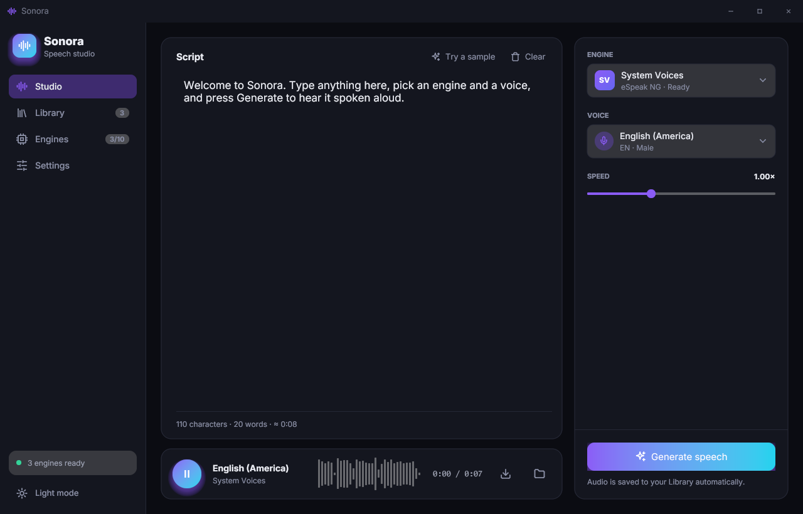
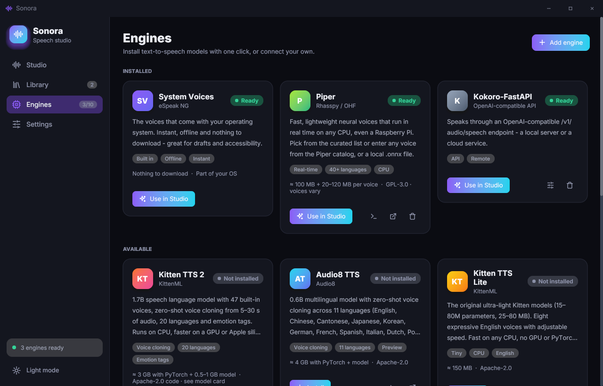
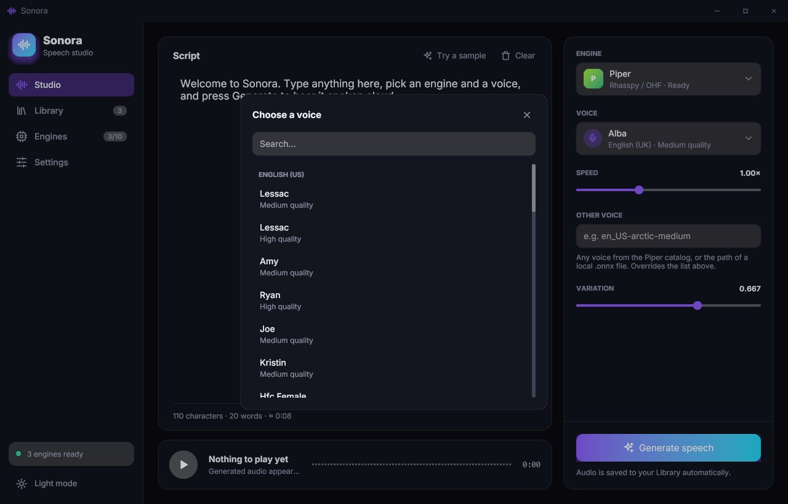
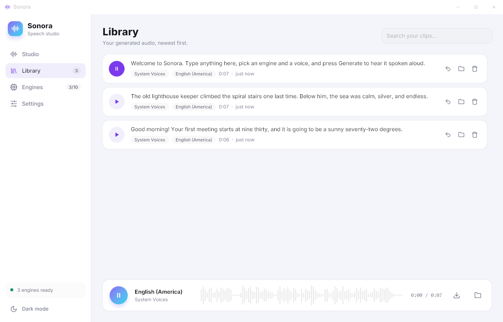

# Sonora

**A speech studio — text to speech and speech to text — with no code, no terminal, no Python setup.**

Type some text (or open a document), pick an engine and a voice, press **Generate**. Or
pick a recording (or record one), press **Transcribe**, and get the text back with
timestamps. Sonora installs models like **Kitten TTS 2**, **IndexTTS** and **Whisper** with
one click, keeps every clip and transcript, and can drive almost any other speech model:
Python models through a small plugin, servers through the OpenAI-compatible speech and
transcription APIs, and command-line programs through a template.

Built in Go with [giode](https://github.com/Mehran9675/giode). Runs on Windows, macOS,
Linux and Android. The layout adapts to the window: narrow windows and phones get a
single scrolling column with a bottom tab bar.

**On Android** models run on the phone itself, offline: install **Kitten TTS Lite**,
**Kokoro**, **Piper** or **ZipVoice** to speak, and **Whisper**, **Parakeet** or
**SenseVoice** to transcribe, from the Engines page. Sonora downloads the model (30 MB for
the smallest, about 600 MB for the largest) and runs it with
[sherpa-onnx](https://github.com/k2-fsa/sherpa-onnx). ZipVoice clones a voice from a
recording right on the phone; Kokoro has a full-precision model and Piper high-quality
voices for phones with memory to spare; Whisper goes up to Large v3 Turbo. API servers
work too — run a server such as [Kokoro-FastAPI](https://github.com/remsky/Kokoro-FastAPI)
on your computer, or use a cloud speech or transcription API, and add it under
*Engines → Add engine*. The Python engines (IndexTTS, Chatterbox, faster-whisper…) are
desktop only: they need PyTorch or CTranslate2, which don't run on Android. Phones read
WAV, MP3, FLAC and Ogg Vorbis audio; other formats (M4A, Opus, video) need ffmpeg, which
desktops can use when it's installed. Clips are saved through the system file
picker or sent to other apps with the share sheet; Back closes dialogs and returns to the
Studio; your script is kept when you switch away.



| Engines | Voices | Library (light theme) |
| --- | --- | --- |
|  |  |  |

## Features

- **One-click engines.** Sonora downloads its own Python (via [uv](https://github.com/astral-sh/uv)),
  creates a private environment per engine, picks the right PyTorch for your GPU, and
  shows progress and logs while it installs. Nothing to configure.
- **Studio.** A large script editor, searchable voice picker, speed control and every
  engine setting rendered as proper controls. **Open file** loads the script from a
  document: text, Markdown, subtitles (SRT, WebVTT), HTML, Word, OpenDocument, EPUB, PDF
  or RTF.
- **Transcribe.** Pick an audio or video file, or record up to 15 minutes, choose the
  language (or let it be detected) and get an editable transcript with timestamps.
  Translate into English, copy, share, save as text or SRT subtitles, or send it to the
  Studio to be spoken. Every transcript is kept with its audio.
- **Voice cloning.** On engines that can clone (Kitten TTS 2, Audio8, IndexTTS, Chatterbox, Coqui, ZipVoice),
  switch to *Clone a voice* and record yourself right in the app — live level meter,
  auto-stop at 30 s, silence trimmed — or pick an audio file.
- **Memory control.** A model stays loaded between generations for speed; **Eject** stops
  its Python process and frees the RAM (or VRAM) whenever you want it back.
- **Player.** A waveform you can click to seek, play/pause, save as WAV, show in folder.
- **Library.** Every clip is kept with its text, engine and voice. Search, replay, export,
  or load a clip's settings back into the Studio.
- **Any model.** Built-in engines, Python plugins, API servers and command-line tools all
  appear in the same list and work the same way.
- **Modern design.** Dark and light themes, a frameless window with a custom title bar,
  the Inter typeface, a violet-to-cyan accent.

## Engines

| Engine | What it's good at | Cloning | Runs on |
| --- | --- | --- | --- |
| **Kitten TTS 2** (KittenML) | 47 voices, 20 languages, emotion tags | ✓ | CPU · GPU · Apple silicon |
| **Audio8 TTS** (Audio8) | 0.6B multilingual, 11 languages | ✓ | CPU · GPU |
| **IndexTTS** (Bilibili) | Expressive zero-shot cloning, emotion control; 2.5 speaks 5 languages | ✓ | GPU recommended |
| **Kitten TTS Lite** | 15–80M models, tiny and fast | – | CPU |
| **Kokoro** | Natural voices in 8 languages, 82M | – | CPU · GPU |
| **Chatterbox** (Resemble AI) | Strong cloning, emotion control | ✓ | GPU recommended |
| **Piper** | Real-time voices in 40+ languages | – | CPU |
| **Coqui TTS** | XTTS-v2 or any of 100+ Coqui models by name | ✓ | CPU · GPU |
| **Hugging Face models** | Any Transformers TTS model by ID (MMS, Bark, VITS…) | – | CPU · GPU |
| **System voices** | Your OS's built-in voices, offline, instant | – | – |
| **Kitten TTS Lite · Kokoro · Piper** *(on device)* | The same models running inside the app, no Python | – | Android |
| **ZipVoice** *(on device)* | Cloning from a recording and its transcript, English and Chinese | ✓ | Android |
| **API server** *(add your own)* | OpenAI, Kokoro-FastAPI, LocalAI, Audio8's server… | – | remote |
| **Command line** *(add your own)* | espeak-ng, piper CLI, `say`, anything that writes WAV | – | local |

Speech to text:

| Engine | What it's good at | Runs on |
| --- | --- | --- |
| **Whisper** (OpenAI, via faster-whisper) | ~100 languages, timestamps, translation to English; Tiny to Large v3 | CPU · NVIDIA GPU |
| **Hugging Face speech recognition** | Any Transformers ASR model by ID (Whisper variants, Moonshine, wav2vec 2.0, MMS…) | CPU · GPU |
| **Whisper** *(on device)* | Tiny, Base, Small or Large v3 Turbo inside the app | Android |
| **Parakeet** (NVIDIA) *(on device)* | Fast and accurate, English + 24 European languages, punctuated | Android |
| **SenseVoice** *(on device)* | Very fast Chinese, Cantonese, English, Japanese, Korean | Android |
| **Transcription API** *(add your own)* | OpenAI, Groq, a local Whisper server… | remote |

Each model has its own license (some, like XTTS-v2, are non-commercial). The engine card
shows it; check it before commercial use.

## Getting started

### Download

Grab the archive for your OS and CPU from the [Releases](https://github.com/Mehran9675/sonora/releases) page and run it. That's it: the
first time you install a Python engine, Sonora downloads its toolchain (~30 MB) by itself.

- **Linux:** System voices need `espeak-ng` (`sudo apt install espeak-ng`); file dialogs
  go through the desktop's XDG portal (standard on GNOME, KDE and most other desktops).
- **macOS:** the app isn't notarized by Apple yet, so the first launch is blocked. Run
  `xattr -dr com.apple.quarantine /Applications/Sonora.app` once (or right-click → Open).
  macOS asks for microphone access the first time you record a voice.
- **Windows:** nothing extra.
- **Optional:** `ffmpeg` lets Sonora accept MP3/OGG from API servers and command-line tools.

### Build from source

Requires Go 1.26+.

```sh
# Linux only: Gio and audio dependencies
sudo apt install gcc pkg-config libwayland-dev libx11-dev libx11-xcb-dev \
  libxkbcommon-x11-dev libgles2-mesa-dev libegl1-mesa-dev libffi-dev \
  libxcursor-dev libvulkan-dev libasound2-dev

go build -o sonora ./cmd/sonora                              # Linux / macOS
go build -ldflags "-H windowsgui" -o sonora.exe ./cmd/sonora  # Windows
```

## Using it

1. **Engines** → press **Install** on an engine (or use *System Voices* right away).
2. **Studio** → write or paste text, choose the engine and voice, press **Generate speech**.
3. Click the waveform to seek; use the download button to save a WAV.
4. **Library** keeps every clip; ↺ loads one back into the Studio.

Settings lets you switch theme, force CPU or GPU, and add a Hugging Face token for gated
models.

## Adding other models

- **A server you run** (or a cloud API): *Engines → Add engine → API server*, enter its
  URL. Voices are read from the server when it lists them.
- **A program on your computer**: *Add engine → Command line*, e.g.
  `espeak-ng -w {output} -v {voice} -f {text_file}`.
- **A Python model**: write an `engine.json` and a ~20-line `adapter.py`, drop them in the
  plugins folder. See [docs/plugins.md](docs/plugins.md).

## Project layout

```
cmd/sonora/            entry point
ui/
  app/                 wiring: services, pages, window
  shell/               title bar, sidebar, frame
  pages/               studio/ engines/ library/ settings/ (one file per part)
  components/          one package per component (picker, waveform, playerbar, …)
  core/ theme/ icons/  shared context, palette & fonts, icon paths
internal/
  engines/             Engine interface + python/ openai/ command/ system/ onnx/ backends
  manager/             engine state for the UI, jobs, friendly errors
  catalog/             finds built-in engines and plugins
  pyenv/               uv toolchain, virtualenvs, downloads
  audio/               clip ops, wav/, playback/, record/, convert/
  library/ settings/ paths/
python/
  runtime/             worker.py + the `sonora` helper package
  engines/<id>/        engine.json + adapter.py for each built-in engine
assets/                fonts and the app icon
tools/makeicon/        draws the app icon
tools/fetchsherpa/     downloads the sherpa-onnx libraries for on-device engines
docs/                  architecture, plugin guide, screenshots
```

See [docs/architecture.md](docs/architecture.md) for how the pieces fit together.

## Releasing

Publishing a GitHub release runs [`.github/workflows/release.yml`](.github/workflows/release.yml),
which builds Windows, macOS and Linux for both x86_64 and arm64 plus an Android APK, and
attaches the archives (`.zip` for Windows and the macOS `.app`, `.tar.gz` for Linux,
`.apk` for Android) to the release.

Android updates only install over an earlier version signed with the same key. To sign
with your own key, add the base64 of a keystore as the `ANDROID_KEYSTORE` repository
secret and its password as `ANDROID_KEYSTORE_PASSWORD`; without them each build is signed
with a throwaway key:

```sh
keytool -genkey -keystore sonora.keystore -alias sonora -keyalg RSA -keysize 2048 -validity 10000
base64 -w0 sonora.keystore   # paste into the ANDROID_KEYSTORE secret
```

To build the APK locally, install the Android SDK and NDK and run:

```sh
go run ./tools/fetchsherpa android     # sherpa-onnx libraries into third_party/
go run gioui.org/cmd/gogio@v0.10.3 -target android -tags sherpa -appid com.sonora.app \
  -icon assets/icon/icon.png -o sonora.apk ./cmd/sonora
```

gogio packs only its own library, so then add `third_party/sherpa-onnx/android/<abi>/*.so`
to the APK under `lib/<abi>/`, zipalign it and sign it again; the release workflow's
*Add native libraries* step does exactly this.

The on-device engines can also be built into the Linux desktop app for testing:

```sh
go run ./tools/fetchsherpa linux-x64
go build -tags sherpa -o sonora ./cmd/sonora
LD_LIBRARY_PATH=third_party/sherpa-onnx/linux-x64 ./sonora
```

## Development

```sh
go test ./...          # unit + integration tests (the worker test uses python3 if present)
GIODE_MCP=1 ./sonora   # exposes the UI over MCP (giode) for automated UI testing
                       # its window tool resizes to a phone, e.g. {"action":"resize","width":400,"height":840}
SONORA_HOME=/tmp/s ./sonora   # use a throwaway data folder
```

The icon is drawn by code. After changing `tools/makeicon`, regenerate the PNGs and the
Windows resources:

```sh
go run ./tools/makeicon assets/icon
go install github.com/tc-hib/go-winres@v0.3.3
(cd cmd/sonora && go-winres make --in winres/winres.json --arch amd64,arm64)
```

## Credits

[giode](https://github.com/Mehran9675/giode) and [Gio](https://gioui.org) for the UI,
[oto](https://github.com/ebitengine/oto) for audio, [uv](https://github.com/astral-sh/uv)
for Python, [sherpa-onnx](https://github.com/k2-fsa/sherpa-onnx) (Apache-2.0) and
[ONNX Runtime](https://onnxruntime.ai) (MIT) for on-device models, [Inter](https://rsms.me/inter/) (SIL OFL) for type, and the authors of every
model Sonora runs.
